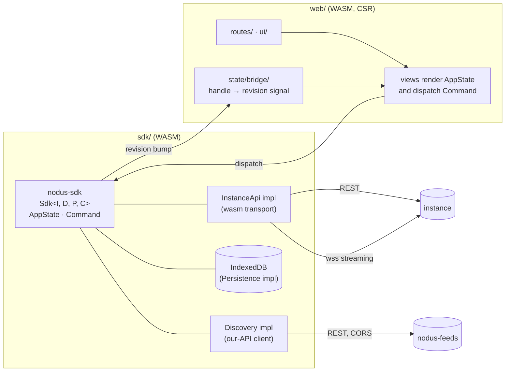

# 02 — Architecture

Status: draft · Last revised: 2026-11-06 (revision 3: the SDK owns client state, and
why the state store is not an actor)

## Shape

Two recommenders, one app:



**The SDK owns client state; the web crate renders it.** Session, timelines,
feed, streaming status, paging and cache policy all live in
[`nodus-sdk`](../../sdk/README.md), which is generic over four ports
(`InstanceApi`, `Discovery`, `Persistence`, `Clock`). `web` contributes: routing,
rendering, sanitisation, keyboard handling, and the ~40-line bridge that adapts an
SDK handle to a Leptos signal.

This is the one structural decision worth defending: without it, pagination and
cache-expiry rules would exist twice — once in the browser and again in the sync
worker — and the two would drift silently. Views that fetch data directly, or hold
copies of SDK state, are a bug ([03-data-layer.md](03-data-layer.md)).

| Concern | Answered by | Origin |
| --- | --- | --- |
| Timelines, threads, notifications, compose, follow | the instance | the user's own host |
| Recommendations, telemetry, sync consent | our API | `PUBLIC_API_BASE` |
| Token | IndexedDB | — |
| Cache | IndexedDB | — |

The split is not an implementation detail: the client must keep working when our
API is down (timelines, compose and follows are all instance calls), and our API
must keep working when a user's instance is slow. The Feed tab is the only view
that degrades to an error card.

### Why not an actor

The reference design we borrowed most of this shape from, `nexia-nextcloud-sdk`,
runs its state as an actor: an `OrchestratorHandle` over `mpsc::Sender<Command>` for
input and `broadcast::Sender<Event>` for output, with the state living on its own OS
thread inside its own tokio runtime. That is the right shape for a background sync
daemon, and it is what we would adopt if the sync loop became one of the browser's
concerns: a daemon has no frame budget, must survive a caller that disappears, and
lives as long as the process rather than as long as a tab.

Ours is the other shape on purpose. `Sdk` is generic over its four ports, mutates
through synchronous `Sdk::dispatch(Command)`, and notifies through `Handle<T>`
callbacks that run on the caller's thread. The reason is the read/write ratio: a UI
store is read far more often than it is written — every state change re-renders a
frame, every read is a `with` on a `RefCell` — while writes are clicks, at human
rates. A broadcast channel would insert a queue, a task and a second scheduling
point between a click and the pixel it changes, and would buy nothing: the
subscriber count is the number of mounted views, and `Handle::notify` already
collects callbacks before running them so a handler may subscribe or unsubscribe
itself mid-notification. `mpsc` exists to cross a thread boundary; in a
single-threaded CSR app there is no boundary to cross, and the ordering an actor
would guarantee is one `RefCell` borrow away for free.

The boundary that keeps the actor design reachable is the port boundary this
document already argues for. If the sync loop ever moves into a web worker,
`Persistence` and `Discovery` become worker messages, `AppState` stays where it is,
and nothing in the state machine is edited: commands still arrive at `dispatch`, the
bridge still adapts handles to signals, and only the transport implementations
learn about `postMessage`. That is the test a port boundary has to pass — it should
be possible to move a thread, a task or a worker to the other side without changing
the trait's consumers. (The `Handle` type would have to move with the state; that is
the seam to design when the worker arrives, and it is why nothing in the state
machine assumes it can reach the DOM.)

The honest cost is backpressure, or the absence of it. `dispatch` runs its
subscribers synchronously on the dispatching task, so a producer that dispatches
faster than the browser can render — a stream socket delivering a burst, or a
replay draining a backlog — can starve a frame, and there is no queue to push back
on. Adding one to the SDK would rebuild the actor we just argued against, so the
mitigation belongs one layer up: the streaming consumer buffers events and coalesces
them into a single dispatch per animation frame, bounding dispatches at one per
frame instead of one per event. That is a UI-layer concern because only the UI knows
what a frame is; the SDK's contribution is that coalescing is expressible at all,
because a `Command` carries a whole page or a whole stream state rather than a
partial mutation.

## Crate layout

```text
Nodus/
├── sdk/                  # submodule: nodus-shared, -instance-*, -state, -runtime, -sdk, -discovery
└── web/
    ├── Cargo.toml        # workspace: crates/web; deps on ../../sdk by path
    ├── Trunk.toml        # build target, dist, dev server + /api proxy, tailwind hook
    ├── rust-toolchain.toml   # stable + wasm32-unknown-unknown
    ├── vendor/daisyUI/   # pinned daisyUI 5 plugin, loaded by path (no npm)
    └── crates/web/
        ├── Cargo.toml    # wasm-only deps
        ├── index.html    # shell: CSP meta, no inline script, wasm preload
        ├── style/        # app.css (Tailwind + @plugin + @source), theme.css (tokens only)
        └── src/
            ├── main.rs   # mount + shell: header, rail, route switch
            ├── router.rs # hand-written: route signal, history, popstate
            ├── state/    # bridge/: SDK handle → revision signal (no other state lives here)
            └── routes/   # feed, settings, sign-in (this milestone); the rest lands with parity
```

Removed by the SDK split, and staying removed: `api/`, `masto/`, `cache/` and
`streaming/` in this crate. They are ports in the SDK now, so a second consumer
(the sync worker) uses the same code.

`crates/web` consumes the SDK by path through the superproject submodule — see
[03-contract.md](../../sdk/docs/03-contract.md) and [sdk/README.md](../../sdk/README.md).

## Rules
 that keep it maintainable

1. **The SDK owns state; views select from it.** A timeline is an entry in
   `AppState::timelines` keyed by `(kind, tag)`, loaded through `Sdk::load_timeline`.
   No component keeps its own copy or its own cache. Navigating back renders the
   SDK's last page instantly and revalidates in the background
   (stale-while-revalidate, implemented once, in the SDK).
2. **Session comes from the SDK.** `AppState::session` is a `Handle<Option<Session>>`;
   a route guard redirects to `/sign-in` when it is `None`. The token never enters
   state — the transport holds it.
3. **No ranking math in the client.** Feed items arrive ranked, with reasons.
   Recomputing would fork the model and make "what was shown" unknowable.
4. **All instance HTTP goes through the SDK's `InstanceApi` port.** `routes/` and
   `ui/` never call `fetch` directly; the SDK's transport is the only place that
   knows endpoint paths, pagination and error mapping.
5. **All our-API HTTP goes through the SDK's `Discovery` port.** One implementation,
   one base URL, one error mapping, one place that attaches `X-Contract-Version`.
6. **No `unsafe`, no `innerHTML` of untrusted text.** Sanitization is a single
   function in `ui/` ([04-ui.md](04-ui.md)).
7. **No signal write after an `await` without an `Alive` guard.** A response can
   arrive after the screen that asked for it is gone, and writing then is a panic in
   `reactive_graph` (`Tried to access a reactive value that has already been
   disposed`) — which unwinds inside a task poll and poisons `js-sys`'s executor, so
   the whole page stops reacting. `crate::state::alive::Alive::new()` in the
   component body plus `alive.if_alive(|| set_x.set(..))` around each post-`await`
   write is the rule; it is a flag rather than `try_update` because the write sites
   must also skip the work the write would trigger.

8. **SSR for every path; the session decides what the server paints.** The server
   renders each route, public or private, so a visitor gets real content and
   crawlers get real markup. When the request carries a session, the authenticated
   view is painted instead — with the first page of data and its cursor already in
   the markup — so there is no "signed-in after the fact" flash: the server never
   paints a stranger's page to an account holder. The client takes over from there
   for what a document cannot do: infinite scroll on the same cursor, streaming,
   and every action. The only client-only screen is the OAuth callback, which has
   nothing to render until it has exchanged a code.
9. **Unknown is a state; never render a default that looks like a decision.** A
   value that has not arrived yet is not "off", "0", "Follow" or "No posts yet".
   Three renders happen before any answer (mount, request, answer), and the middle
   one must not show content that then changes — that flicker reads as a bug even
   when the final value is right. Render the absence: a dimmed placeholder, a
   disabled control, or nothing. `Handle<Option<T>>` in the SDK is how a value gets
   a third state; `SyncConsent` uses it. Where a value can be known before first
   paint, put it there instead — the stored session is adopted, not re-asked.

## Routing

| Route | View | Data source |
| --- | --- | --- |
| `/` (default) | Feed tab | our API |
| `/home` | home timeline | instance |
| `/local`, `/federated` | public timelines | instance |
| `/tags/:tag` | hashtag timeline | instance |
| `/lists/:id` | list timeline | instance |
| `/status/:id` | thread | instance |
| `/@acct` → `/accounts/:id` | profile | instance |
| `/notifications` | notifications | instance |
| `/search` | search | instance |
| `/bookmarks`, `/favourites` | saved | instance |
| `/compose` | compose (also a modal) | instance |
| `/settings/*` | settings | local + our API (consent) |
| `/sign-in` | instance picker + PKCE | instance |

The Feed is the default landing route because it is the product; `/home` is one
keystroke away (`g h`). This is a deliberate product bet and it is easy to flip
if usage data disagrees.

## Streaming

One WebSocket per instance, `stream=user`, opened after sign-in:

- events are typed (`update`, `notification`, `delete`, `filters_changed`,
  `conversation`, …) and fanned out to whoever subscribed (timeline resource,
  notification resource);
- **gap detection**: each timeline keeps a `since_id`; if a stream event arrives
  with an id more than one page ahead, or after a reconnect, the resource
  refetches rather than pretending continuity;
- reconnect: exponential backoff with jitter, capped at 30 s, paused while the
  document is hidden (`visibilitychange`) and resumed on focus;
- the token is in the query string because Mastodon requires it: the URL is never
  rendered, never logged, and the connection is closed on sign-out.

The Feed tab does **not** stream; it refreshes on mount, on `POST
/feed/:id/refresh` throttle, and after a follow event invalidates a batch.

## Error handling

| Failure | Where | Behaviour |
| --- | --- | --- |
| Instance 401 | `mastodon` crate | sign-out flow, "session expired — sign in again" with the instance preserved |
| Instance 429 | `mastodon` crate | backoff honouring `Retry-After`, toast, retry the resource |
| Instance 5xx/network | resource | inline retry card in that view only; the rest of the app keeps working |
| Our API down | Feed view | error card with "recommendations unavailable, timelines unaffected" |
| Contract too old | `api/` | banner: client cannot talk to this server; update screen for `426` |
| IndexedDB denied | `cache/` | memory-only mode, one toast, no repeated nagging |

## Deployment

The client is static files on a CDN, so **production is cross-origin** to our
API. Three consequences that are contract obligations, not deployment details:

1. `WEB_ORIGINS` on the API must list the exact client origin (no wildcards).
2. The client ships a strict CSP (`script-src 'self'`, `connect-src` limited to
   the API base and the user's instance hosts, `img-src` to instance media hosts,
   `frame-ancestors 'none'`).
3. Hashed assets are `immutable`, `index.html` is `no-cache`, and the host does
   SPA fallback to `index.html` for unknown paths. A versioned deploy under
   `/v/<hash>/` is allowed and preferred because it makes rollback a CDN switch.

Development: `trunk serve --port 8080` proxies `/api` to the recommender on `:3000`,
so the dev origin contains no CORS surprises.

10. **Moderation uses its own token.** `/api/v1/admin/*` needs `admin:read`/`admin:write`
    on both the app and the token, so the ordinary session is registered without them: a
    consent screen for every user should not read like a moderator's. The Administration
    tab offers a grant, which authorizes a second app for that instance, verifies the
    resulting token against the report queue and keeps it in `nodus-admin/1` — used only
    by the admin calls, forgotten on sign-out and on request. A token that cannot
    moderate is never a `false` the UI can hide behind: "no grant" and "the instance said
    no" are different answers.

11. **The SDK is the store; a screen is a reader.** The SDK lives beside the app for the
    whole session: it holds the data (`AppState`), the freshness of that data
    (`fetched_at` per page, entities keyed by id), and the housekeeping (the driver
    decides when to backfill, the socket decides what to correct). A screen asks for what
    it needs and subscribes to changes; it does not own a copy of a list, and it does not
    fetch on mount unless the store has nothing. Concretely: read through
    `state::bridge::{timeline, pages}` (which call `Sdk::read_timeline` / `Sdk::page`),
    ask for a load with `ensure*` (TTL-aware, cheap when fresh), use `refresh` only after
    this client changed something the store still believes, and render from `revision()`
    so socket frames and ticks repaint without a reload.
