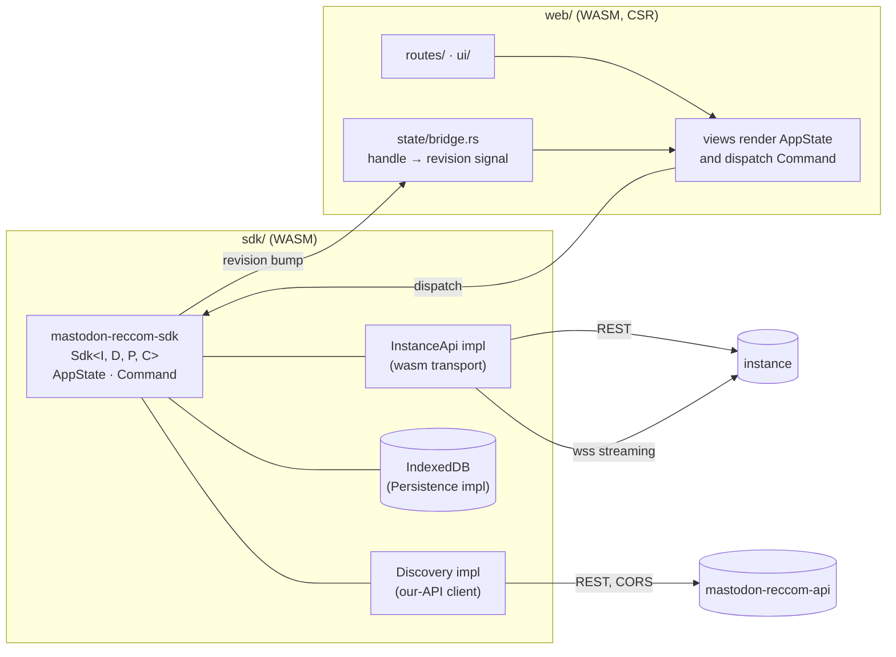

# 02 — Architecture

Status: draft · Last revised: 2026-11-06 (revision 2: the SDK owns client state)

## Shape

Two backends, one app:



**The SDK owns client state; the web crate renders it.** Session, timelines,
feed, streaming status, paging and cache policy all live in
[`mastodon-reccom-sdk`](../../sdk/README.md), which is generic over four ports
(`InstanceApi`, `Discovery`, `Persistence`, `Clock`). `web` contributes: routing,
rendering, sanitisation, keyboard handling, and the ~40-line bridge that adapts an
SDK handle to a Leptos signal.

This is the one structural decision worth defending: without it, pagination and
cache-expiry rules would exist twice — once in the browser and again in the sync
worker — and the two would drift silently. Views that fetch data directly, or hold
copies of SDK state, are a bug ([03-data-layer.md](03-data-layer.md)).

| Concern | Answered by | Origin |
| --- | --- | --- |
| Timelines, threads, notifications, compose, follow | the instance | the user's own host |
| Recommendations, telemetry, sync consent | our API | `PUBLIC_API_BASE` |
| Token | IndexedDB | — |
| Cache | IndexedDB | — |

The split is not an implementation detail: the client must keep working when our
API is down (timelines, compose and follows are all instance calls), and our API
must keep working when a user's instance is slow. The Feed tab is the only view
that degrades to an error card.

## Crate layout

```text
MastodonReccom/
├── sdk/                  # submodule: mastodon-reccom-shared, -mastodon, -sdk
└── web/
    ├── Cargo.toml        # workspace: crates/web; deps on ../../sdk by path
    ├── Trunk.toml        # build target, dist, dev server + /api proxy
    ├── rust-toolchain.toml   # stable + wasm32-unknown-unknown
    └── crates/web/
        ├── Cargo.toml    # wasm-only deps
        ├── index.html    # shell: CSP meta, no inline script, wasm preload
        ├── style/        # plain CSS, custom properties for theming
        └── src/
            ├── main.rs   # mount + global providers (session, i18n, toasts)
            ├── app.rs    # shell: layout, nav, route table, keyboard router, error boundary
            ├── state/    # bridge.rs: SDK handle → revision signal (no other state lives here)
            ├── routes/   # home, local, federated, tag, list, thread, profile,
            │             # notifications, search, bookmarks, favourites, feed,
            │             # settings, compose, about, sign-in
            └── ui/       # status card, media grid, poll, avatar, editor, dialog, toast, skeleton
```

Removed by the SDK split, and staying removed: `api/`, `masto/`, `cache/` and
`streaming/` in this crate. They are ports in the SDK now, so a second consumer
(the sync worker) uses the same code.

`crates/web` consumes the SDK by path through the superproject submodule — see
[08-sdk.md](../../backend/docs/08-sdk.md) and [sdk/README.md](../../sdk/README.md).

## Rules that keep it maintainable

1. **The SDK owns state; views select from it.** A timeline is an entry in
   `AppState::timelines` keyed by `(kind, tag)`, loaded through `Sdk::load_timeline`.
   No component keeps its own copy or its own cache. Navigating back renders the
   SDK's last page instantly and revalidates in the background
   (stale-while-revalidate, implemented once, in the SDK).
2. **Session comes from the SDK.** `AppState::session` is a `Handle<Option<Session>>`;
   a route guard redirects to `/sign-in` when it is `None`. The token never enters
   state — the transport holds it.
3. **No ranking math in the client.** Feed items arrive ranked, with reasons.
   Recomputing would fork the model and make "what was shown" unknowable.
4. **All instance HTTP goes through the SDK's `InstanceApi` port.** `routes/` and
   `ui/` never call `fetch` directly; the SDK's transport is the only place that
   knows endpoint paths, pagination and error mapping.
5. **All our-API HTTP goes through the SDK's `Discovery` port.** One implementation,
   one base URL, one error mapping, one place that attaches `X-Contract-Version`.
6. **No `unsafe`, no `innerHTML` of untrusted text.** Sanitization is a single
   function in `ui/` ([04-ui.md](04-ui.md)).

## Routing

| Route | View | Data source |
| --- | --- | --- |
| `/` (default) | Feed tab | our API |
| `/home` | home timeline | instance |
| `/local`, `/federated` | public timelines | instance |
| `/tags/:tag` | hashtag timeline | instance |
| `/lists/:id` | list timeline | instance |
| `/status/:id` | thread | instance |
| `/@acct` → `/accounts/:id` | profile | instance |
| `/notifications` | notifications | instance |
| `/search` | search | instance |
| `/bookmarks`, `/favourites` | saved | instance |
| `/compose` | compose (also a modal) | instance |
| `/settings/*` | settings | local + our API (consent) |
| `/sign-in` | instance picker + PKCE | instance |

The Feed is the default landing route because it is the product; `/home` is one
keystroke away (`g h`). This is a deliberate product bet and it is easy to flip
if usage data disagrees.

## Streaming

One WebSocket per instance, `stream=user`, opened after sign-in:

- events are typed (`update`, `notification`, `delete`, `filters_changed`,
  `conversation`, …) and fanned out to whoever subscribed (timeline resource,
  notification resource);
- **gap detection**: each timeline keeps a `since_id`; if a stream event arrives
  with an id more than one page ahead, or after a reconnect, the resource
  refetches rather than pretending continuity;
- reconnect: exponential backoff with jitter, capped at 30 s, paused while the
  document is hidden (`visibilitychange`) and resumed on focus;
- the token is in the query string because Mastodon requires it: the URL is never
  rendered, never logged, and the connection is closed on sign-out.

The Feed tab does **not** stream; it refreshes on mount, on `POST
/feed/:id/refresh` throttle, and after a follow event invalidates a batch.

## Error handling

| Failure | Where | Behaviour |
| --- | --- | --- |
| Instance 401 | `mastodon` crate | sign-out flow, "session expired — sign in again" with the instance preserved |
| Instance 429 | `mastodon` crate | backoff honouring `Retry-After`, toast, retry the resource |
| Instance 5xx/network | resource | inline retry card in that view only; the rest of the app keeps working |
| Our API down | Feed view | error card with "recommendations unavailable, timelines unaffected" |
| Contract too old | `api/` | banner: client cannot talk to this server; update screen for `426` |
| IndexedDB denied | `cache/` | memory-only mode, one toast, no repeated nagging |

## Deployment

The client is static files on a CDN, so **production is cross-origin** to our
API. Three consequences that are contract obligations, not deployment details:

1. `WEB_ORIGINS` on the API must list the exact client origin (no wildcards).
2. The client ships a strict CSP (`script-src 'self'`, `connect-src` limited to
   the API base and the user's instance hosts, `img-src` to instance media hosts,
   `frame-ancestors 'none'`).
3. Hashed assets are `immutable`, `index.html` is `no-cache`, and the host does
   SPA fallback to `index.html` for unknown paths. A versioned deploy under
   `/v/<hash>/` is allowed and preferred because it makes rollback a CDN switch.

Development: `trunk serve --port 8080` proxies `/api` to the backend on `:3000`,
so the dev origin contains no CORS surprises.
